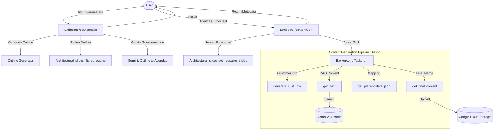

# PitchGen ADK External

PitchGen ADK External is a consolidated, production-ready Python application designed to automate and accelerate the creation of sales pitches and presentation slides. It leverages Google's Vertex AI, GenAI SDK, and the Agent Development Kit (ADK) to dynamically generate presentation outlines, slide content, and map them to high-quality corporate templates.

The application is structured as a dual-interface system:
1.  **FastAPI Web Service (`main.py`)**: Provides REST endpoints for integration with frontend applications.
2.  **ADK Agent (`agent.py`)**: A standalone, payload-driven autonomous agent that encapsulates the core slide generation skills.

---

## Business Context & Ecosystem

PitchGen is a core component of the **Google Cloud Sales Enablement** suite, integrated under the **Pitch & Proposal Hub (go/phub)**—the central platform on CloudHub where Google Cloud sales teams request customized assets (pitches, proposals, demos, 1-Pagers, QBRs) and access self-service enablement tools.

Specifically, PitchGen serves as the backend engine powering the **PitchGen Google Slides Extension (go/pitchgen)**. It enables sales representatives and engineers to:
*   **Accelerate Asset Creation**: Automate the tedious process of building customer-specific presentations from scratch.
*   **Maintain Brand Consistency**: Automatically map generated copy into approved, high-quality Google Cloud presentation templates.
*   **Ensure Technical & Factual Accuracy**: Ground generated slide content in verified technical details (via Vertex AI Search and RAG) rather than relying on generic AI outputs.
*   **Tailor to the Customer**: Seamlessly inject customized customer research, SWOT analyses, and tailored solution mappings into the slides.
*   **Promote Asset Reuse**: Automatically search and retrieve existing, pre-approved architectural and product slides (reusable assets) that match the customer's solution requirements, avoiding redundant work and ensuring aligned messaging.


---

## 1. Architecture Overview

The application orchestrates a multi-step pipeline combining retrieval-augmented generation (RAG) with layout mapping.



For a detailed breakdown of components and data structures, see [FLOW_DIAGRAM.md](FLOW_DIAGRAM.md).

---

## 2. Key Features

*   **Agenda Generation**: Transforms high-level business context (customer, audience, industry, products) into a structured presentation outline.
*   **Smart Content Generation (RAG)**: Pulls contextual information using Vertex AI Search and Google Search to generate factual, customer-specific slide copy.
*   **Template Mapping**: Classifies generated slide copy and maps it to specific placeholder variables in corporate slide templates.
*   **Image Generation (Nano Banana)**: Integrates with **Nano Banana 2** (`gemini-3.1-flash-image-preview`) and **Nano Banana Pro** (`gemini-3-pro-image-preview`) for generating custom visual slides with high-fidelity text rendering.
*   **Intelligent Reusable Asset Search**: Automatically queries internal databases (via the `Architectural_slides` skill) to find matching, pre-approved "reusable" slides (such as standard architecture diagrams or customer success stories) based on the generated outline.
*   **Ad-hoc Slide Search**: Provides endpoints (`/searchSlide`) to perform semantic vector searches across existing slide repositories to find and pull specific slides into the deck.
*   **Slide Translation**: Translates decks into target languages while preserving visual formatting and layout.
*   **Slide Reshuffling**: Allows users to iteratively transform or regenerate specific slides.

---

## 3. Directory Structure

```
pitchgen_adk_external/
├── agent.py                  # ADK Agent interface & standalone execution
├── main.py                   # FastAPI Web application & endpoints
├── app.yaml                  # App Engine configuration
├── cloudbuild.yaml           # GCP Cloud Build trigger configuration
├── requirements.txt          # Cleaned production dependencies
├── .env.example              # Template for environment variables
├── FLOW_DIAGRAM.md           # Detailed architectural documentation
├── config/
│   ├── config.ini            # Local active configuration (git-ignored)
│   ├── config.ini.example    # Template for INI configurations
│   └── *mapping.json         # Static industry/layout mappings
├── prompt_templates/         # System and user prompts for Gemini LLM calls
├── templates_metadata/       # Slide layout descriptions for template mapping
├── src/                      # Core application module (FastAPI backend)
│   ├── new_content_gen.py    # RAG & text generation logic
│   ├── outline_generator.py  # Outline creation logic
│   ├── reusable_slides.py    # Retrieval of existing assets
│   ├── template_sorting.py   # Placeholder mapping logic
│   └── ...
└── src_agent/                # ADK Agent specific skills
    └── skills/
        ├── content_generator.py
        └── template_selector.py
```

---

## 4. Setup & Installation

### Prerequisites
*   Python 3.11+
*   A Google Cloud Project with Vertex AI and Discovery Engine enabled.
*   A GCS bucket for storing generated outputs.

### Step 1: Install Dependencies
```bash
pip install -r requirements.txt
```

### Step 2: Environment Configuration
1.  Copy `.env.example` to `.env`:
    ```bash
    cp .env.example .env
    ```
2.  Fill in your Google Cloud Project details in `.env`:
    ```env
    GOOGLE_GENAI_USE_VERTEXAI=1
    GOOGLE_CLOUD_PROJECT=your-gcp-project-id
    GOOGLE_CLOUD_LOCATION=global
    MODEL=gemini-3.5-flash
    IMAGE_MODEL=gemini-3.1-flash-image-preview
    ```

### Step 3: Application Configuration
1.  Copy `config/config.ini.example` to `config/config.ini`:
    ```bash
    cp config/config.ini.example config/config.ini
    ```
2.  Configure your GCP resources, GCS buckets, and Vertex AI Search datastore IDs in `config/config.ini`.

#### Model Configuration in `config.ini`:
*   `gemini_model` / `gemini_model_1`: Primary and fallback text models (e.g., `gemini-3.5-flash` or `gemini-3.1-pro-preview`).
*   `gemini_model_2`: The active image generation model.
*   `gemini_image_flash_model`: Explicitly configured as `gemini-3.1-flash-image-preview` (Nano Banana 2).
*   `gemini_image_pro_model`: Explicitly configured as `gemini-3-pro-image-preview` (Nano Banana Pro).

*Note: The environment variable `MODEL` will override the text models (`gemini_model`/`gemini_model_1`), while `IMAGE_MODEL` will override `gemini_model_2`.*

---

## 5. Running the Application

### Running the FastAPI Web Service (Local)
You can run the API server locally using Uvicorn:
```bash
uvicorn main:app --reload --port 8080
```
The interactive API documentation will be available at `http://localhost:8080/docs`.

### Running the ADK Agent (Standalone Test)
You can run a standalone test execution of the ADK agent payload mapping:
```bash
python3 agent.py
```
This executes the agent with a mock payload defined in the `__main__` block of `agent.py`.

---

## 6. Production Deployment

The application is configured for deployment to **Google App Engine (Standard Environment)**.

### Deploying via gcloud CLI
```bash
gcloud app deploy --project=your-gcp-project-id --quiet
```

### Deploying via Cloud Build
A `cloudbuild.yaml` is provided to automate deployment via GCP Cloud Build:
```bash
gcloud builds submit --config=cloudbuild.yaml --project=your-gcp-project-id
```
