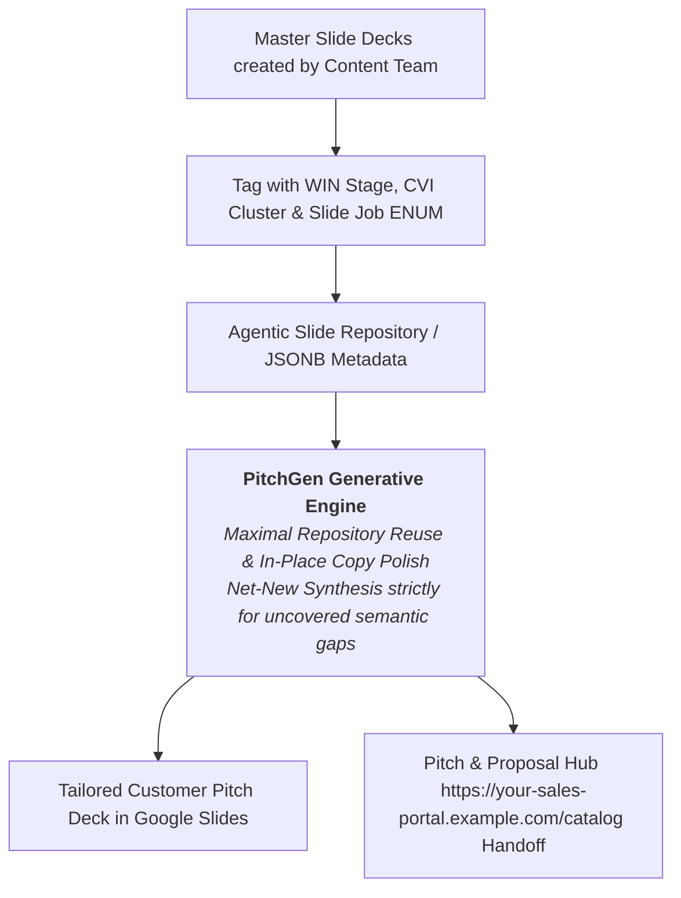
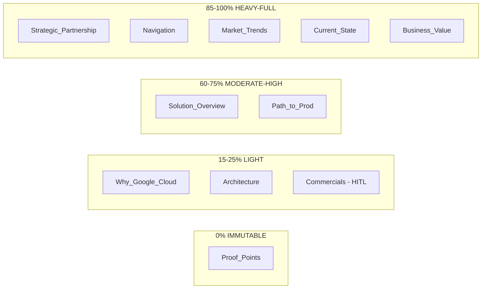
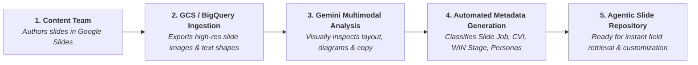

# Google Cloud GTM Content Team Guide: Agentic Slide Orchestration, WIN Cycle & CVI Taxonomy

> [!IMPORTANT]
> **To the Google Cloud GTM Content Team**: As the creators of our core sales play decks, Executive Briefing Center (EBC) presentations, and master slide templates, your base content is the foundation of our AI-powered Google Slides presentation engine (**PitchGen** / `https://your-sales-portal.example.com/pitchgen`).
> 
> This document provides a comprehensive guide to our **intent-based slide orchestration architecture**—explaining how the **WIN Cycle ("What's Important Now")**, **Customer Value Imperative (CVI) Framework**, **Presentation Archetypes**, and **Slide Job Taxonomy** govern how AI agents retrieve, assemble, and customize your slides for field sales teams. Please review this document and use it as a reference when building, tagging, and contributing new base slide content.

---

## 1. Executive Summary: Intent-Based Slide Orchestration & Reuse-First Strategy

Historically, sales slide repositories relied on legacy keyword searches (e.g., searching for "BigQuery" or "Security"). This often resulted in disjointed pitch decks that dumped product slides without a coherent customer narrative.

To enable **PitchGen** and our autonomous GTM agents to generate narrative-driven presentations automatically, we categorize slides not just by *"what is on them"* (products), but by **"what they do" in a sales conversation**. Our agentic orchestrator uses three coordinated layers:
1.  **Macro Stage Layer**: **WIN Cycle Deal Stage** (`Planning`, `S0`, `S1`, `S2`, `S3`, `S4'`, `S0'`) and **BOM Presentation Archetype**
2.  **Narrative Flow Layer**: **CVI Cluster** (`Context`, `Vision`, `Impact`, `Realization`)
3.  **Micro Intent Layer**: **Slide Job ENUM** (11 strictly defined tactical slide intents)

### The "Maximal Reuse & In-Place Transformation" Paradigm
Because PitchGen features granular in-place **Text Transformation** (`TextTransformerWorkflow` / `enterprise_transform_slide_text_skill`), our presentation engine aggressively prioritizes retrieving your high-fidelity, brand-approved master slides and **transforming their text in-place** while preserving your layout, diagrams, visual assets, and typography.

We **always push for the highest possible repository reuse (aiming for 100% coverage)** across the presentation. Net-new slide synthesis is strictly an emergent, exception-based fallback used *only* when no existing slide in the repository matches a required topic.

---

## 2. The WIN Cycle & BOM Presentation Archetypes

Presentations are generated to support specific milestones in Google Cloud's **WIN ("What's Important Now") Cycle**. Each deal stage maps directly to a **Bill of Materials (BOM) Presentation Archetype**:

| WIN Cycle Stage | BOM Presentation Archetype | Primary Audience & Roles | Stage Objective & Exit Criteria Targeted | Dominant Slide Jobs & Weighting Profile | Technical Maturity |
| :--- | :--- | :--- | :--- | :--- | :--- |
| **Planning & Lead Gen / S0** | **`Executive_Vision_Thought_Leadership`** | `CEO`, `Board`, `EVP/SVP` **Lead**: KAx/FSR/BDR **Support**: Platform/Practice CE | **Objective**: Inspire with macro trends and Art-of-the-Possible. **Exit Criteria**: Strategic account plan, executive sponsorship. | • **`Market_Trends` (35%)** • **`Strategic_Partnership` (25%)** • **`Why_Google_Cloud` (25%)** • **`Navigation` (15%)** | `L100 (Conceptual)` |
| **Qualify (S0)** | **`Discovery_First_Call`** | LOB Leaders, Directors **Lead**: KAx/FSR/Sales Spec **Support**: Partners, Delta, SCE | **Objective**: Align on business problem to solve. **Exit Criteria**: Validated Opportunity Statement; champion sponsored discovery. | • **`Current_State` (40%)** • **`Market_Trends` (25%)** • **`Why_Google_Cloud` (20%)** • **`Navigation` (15%)** | `L100 (Conceptual)` |
| **Position & Build (S1)** | **`Executive_Vision_Strategic`** | `CxO`, `Board`, `President`, `GM` **Lead**: KAx/FSR/Sales Spec **Support**: GCC, Platform CE, Value Creation | **Objective**: Co-create strategic partnership proposition. **Exit Criteria**: Validated solution roadmap; initial commercial framework; RaMP engaged. | • **`Strategic_Partnership` (35%)** • **`Current_State` (20%)** • **`Business_Value` (20%)** • **`Why_Google_Cloud` (15%)** • **`Path_to_Prod` (10%)** | `L100 (Conceptual)` |
| **Position & Build (S1)** | **`Industry_Business_Pitch`** | Business Unit Leads, Industry Execs **Lead**: KAx/FSR/Sales Spec **Support**: GCC, Platform CE, CLS | **Objective**: Deliver clarity on conceptual domain solution & ROI. **Exit Criteria**: Prioritized use cases; LOB sponsor agreement. | • **`Current_State` (25%)** • **`Market_Trends` (25%)** • **`Solution_Overview` (30%)** • **`Business_Value` (20%)** | `L100`–`L200` |
| **Position & Build (S1–S3)** | **`CFO_Business_Case`** | `CFO`, `VP Finance`, FinOps, Procurement **Lead**: KAx/FSR/Sales Spec **Support**: Value Creation, Delta, CLS | **Objective**: Establish undisputed financial justification & ROI. **Exit Criteria**: Confirmed NPV, TCO reduction, payback `<12–18 months`. | • **`Business_Value` (45%)** • **`Proof_Points` (20%)** • **`Commercials` (20%)** • **`Current_State` (15%)** | `L100`–`L200` |
| **Technical Solutioning (S2)** | **`CIO_Technical_Strategy`** | `CIO`, `CTO`, Head of Architecture **Lead**: Platform CE **Support**: KAx/FSR, GCC/Partners, DPO | **Objective**: Solution enterprise architecture yielding validated design. **Exit Criteria**: Technical & product wins established; draft capacity plan. | • **`Solution_Overview` (30%)** • **`Architecture` (30%)** • **`Why_Google_Cloud` (25%)** • **`Path_to_Prod` (15%)** | `L200 (Strategic)` |
| **Technical Solutioning (S2)** | **`Practitioner_Technical_Architecture`** | Lead Architects, Engineers, Developers **Lead**: Platform CE **Support**: Practice CE, GCC | **Objective**: Provide granular reference blueprints and data flows. **Exit Criteria**: Lead CE technical win; VPC-SC boundaries validated; zero lock-in. | • **`Architecture` (45%)** • **`Solution_Overview` (25%)** • **`Why_Google_Cloud` (15%)** • **`Path_to_Prod` (15%)** | `L300 (Deep Technical)` |
| **Technical Solutioning (S2)** | **`PoC_Engagement_Proposal`** | Technical Project Leads, BDM **Lead**: Platform CE **Support**: GCC/Partners, CLS | **Objective**: Agree on PoC scope, success criteria, and modules. **Exit Criteria**: Formalized PoC charter, test datasets, deployment timelines. | • **`Path_to_Prod` (35%)** • **`Solution_Overview` (25%)** • **`Architecture` (25%)** • **`Commercials` (15%)** | `L200`–`L300` |
| **Propose & Negotiate (S3)** | **`PoC_Results_Value`** | Buying Committee, CIO, CTO, BDM **Lead**: KAx/FSR/Sales Spec **Support**: Platform/Outcome CE, Delta | **Objective**: Demonstrate validated PoC technical & business value. **Exit Criteria**: Proven empirical benchmark results; path to prod confirmed. | • **`Proof_Points` (40%)** • **`Business_Value` (30%)** • **`Architecture` (15%)** • **`Path_to_Prod` (15%)** | `L200` |
| **Propose & Negotiate (S3)** | **`Commercial_Proposal`** | Procurement, Sourcing, Buying Committee **Lead**: KAx/FSR/Sales Spec **Support**: Platform/Outcome CE, CLS | **Objective**: Confirm commercial terms, pricing models, and delivery. **Exit Criteria**: Contracts signed; EDP/CUD pricing secured; delivery ramp in place. | • **`Commercials` (40%)** • **`Path_to_Prod` (30%)** • **`Strategic_Partnership` (20%)** • **`Business_Value` (10%)** | `L100`–`L200` |
| **Mobilize & Deliver (S4')** | **`Customer_Adoption_Playbook`** | Delivery Teams, CALs, TAMs, GCC **Lead**: GCC / Partners **Support**: Outcome CE, Platform CE, TAMs | **Objective**: Move to production driving day-one success. **Exit Criteria**: Shared delivery ownership; go-live plan executed; initial value realized. | • **`Path_to_Prod` (45%)** • **`Solution_Overview` (25%)** • **`Strategic_Partnership` (20%)** • **`Navigation` (10%)** | `L200` |
| **Optimize & Grow (S0')** | **`Executive_QBR_Value_Realization`** | C-Suite, Joint Steering Committee **Lead**: KAx/FSR/Sales Spec **Support**: Platform CE, GCC/Partners, CALs | **Objective**: Drive adoption, value realization, and next workloads. **Exit Criteria**: C-suite partnership strengthened; new opportunity restarts WIN Cycle. | • **`Proof_Points` (35%)** • **`Business_Value` (30%)** • **`Strategic_Partnership` (20%)** • **`Path_to_Prod` (15%)** | `L100`–`L200` |

---

## 3. The Narrative Layer: CVI Framework & 4 CVI Clusters

The **Customer Value Imperative (CVI) Framework** (`@cvi-framework`) divides the buyer's transformation journey into **4 authoritative CVI Clusters**:

| CVI Cluster | Core Buyer Question | Narrative Role in Presentation |
| :--- | :--- | :--- |
| **`Context`** | *Why Change?* | Establishes market conditions, regulatory updates, and legacy friction. Validates the customer's macro and micro realities before pitching products. |
| **`Vision`** | *What is the Future?* | Paints the target destination. Focuses on capabilities, target state architecture, and the conceptual "art of the possible" using Google Cloud. |
| **`Impact`** | *What is the Value?* | Translates the technical vision into financial and strategic metrics (ROI, TCO reduction, NPV, efficiency gains). |
| **`Realization`** | *How to Execute?* | De-risks the buying decision. Outlines structured paths to production, governance, Cloud Adoption Framework (CAF) stages, and partner delivery. |
| *(Connective)* | *How is Deck Structured?* | Connective tissue: title slides, agendas, executive summaries, and section dividers. |

---

## 4. The Micro Layer: The 11 Authoritative Slide Job ENUMs

Every master slide must be tagged with exactly one **Slide Job ENUM** (`@slide-job`):

| Slide Job ENUM | Mapped CVI Cluster | Content Team Writing Guidelines & Slide Anatomy | Target Audience & Technical Maturity |
| :--- | :--- | :--- | :--- |
| **`Navigation`** | `Connective Tissue` | **Set up the deck.** Title slides, agendas, section dividers, executive summaries. Keep text clean and scannable; avoid dense body copy. | `CxO`, `BDM`, `TDM`   `L100 (Conceptual)` |
| **`Market_Trends`** | `Context` | **Show industry context.** Cite quantitative external benchmarks (Gartner, IDC) and macro industry forces (e.g., AI disruption, regulatory mandates). | `CxO`, `BDM`   `L100 (Conceptual)` |
| **`Current_State`** | `Context` | **Reflect specific pain.** Illustrate typical legacy IT bottlenecks, data silos, discovery recaps, and operational friction before Google Cloud. | `BDM`, `TDM`   `L100`–`L200` |
| **`Why_Google_Cloud`** | `Vision` | **Show our differentiators.** Focus on planetary scale, custom TPUs, open-source commitments, security-by-default, and **Gemini Enterprise Agent Platform** leadership. | `CxO`, `BDM`, `TDM`   `L100`–`L200` |
| **`Solution_Overview`** | `Vision` | **Show the front-end product.** Present 3–4 high-level capability pillars, UI mockups, and user experiences. Keep explanations outcome-focused. | `BDM`, `TDM`   `L100`–`L200` |
| **`Architecture`** | `Vision` | **Show the back-end technicals.** Provide rigorous technical system blueprints (ingestion -> processing -> AI -> serving), node flows, and product boundaries. | `TDM`, `Architect_Engineer`   `L200`–`L300 (Deep)` |
| **`Strategic_Partnership`** | `Vision` / `Realization` | **Show executive alignment & co-innovation.** Present One Google / Alphabet synergies (Search, Ads, Android, Cloud), Joint Steering Committee governance, and joint business plans. | `CEO`, `CxO`, `Board`   `L100 (Conceptual)` |
| **`Business_Value`** | `Impact` | **Show financial justification.** Present ROI projections, TCO reduction models, Net Present Value (NPV), and payback periods (`<12–18 months`) for `@cfo-persona`. | `CxO`, `BDM`   `L100`–`L200` |
| **`Proof_Points`** | `Impact` | **Prove we've done it.** Present verified customer case studies, logo slides, anonymized metrics, quotes, or Gartner/Forrester Magic Quadrants. | `CxO`, `BDM`, `TDM`   `L100`–`L200` |
| **`Commercials`** | `Realization` | **Talk pricing & investment.** Present standard consumption models, Enterprise Discount Programs (EDP), and pricing structures. *(Note: AI customization is restricted to **15% Light / HITL Required**).* | `CxO`, `BDM`   `L100`–`L200` |
| **`Path_to_Prod`** | `Realization` | **Show next steps & timelines.** Present 30-60-90 day roadmaps, Cloud Adoption Framework (CAF) stages, PoC milestones, and migration plans. | `BDM`, `TDM`, `Architect`   `L200`–`L300` |

---

## 5. Account Customization Intensity: How AI Treats Your Master Slides

When a field sales representative prompts PitchGen to: *"Customize this sales play deck for Nike"* (or Starbucks, Ford, etc.), our **Customization Intensity Engine** uses your slide's `slide_job` tag to throttle AI modifications from **0% to 100%**:

### What This Means for Content Authors:
1.  **`Proof_Points` (0% IMMUTABLE)**: You can safely write detailed customer reference slides (e.g., Home Depot, Adidas, Walmart). The AI is hard-coded to **never replace third-party customer logos, names, or quotes** with the target account name.
2.  **`Market_Trends` (Cited Benchmark Integrity - 0% Metric Mutation)**: When slides contain third-party research citations (e.g., BCG, Gartner, IDC, Forrester, PYMNTS) and empirical benchmarks (`$52M`, `81%`, `258 days`), the AI will **never spoof or rebrand the measured population** (e.g., changing *"firms"* to *"OEMs"*) or metric definitions. The AI bridges the macro research to the target vertical strictly via consultative slide headers and takeaways.
3.  **`Why_Google_Cloud` & `Architecture` (15–25% LIGHT / LIGHT_MOD)**: Your core Google Cloud platform differentiators (`Gemini Enterprise Agent Platform`, `BigQuery`, custom TPUs) and back-end blueprints will be preserved. The AI will only customize edge ingestion labels (e.g., *"POS Scanner Feeds"* or *"SNKRS App Telemetry"*) and downstream serving context.
4.  **`Commercials` (15% LIGHT - HITL Required)**: The AI is prohibited from inventing or altering discount percentages, Committed Use Discount (CUD) tiers, or EDP terms without Human-In-The-Loop (HITL) verification.
5.  **`Strategic_Partnership`, `Current_State`, `Business_Value` (85–100% FULL)**: Your bullet points and financial models in these slides serve as structural templates that the AI will personalize to the target customer's macro industry challenges, joint co-innovation goals, and CFO KPIs.

---

## 6. Slide Count Budgeting & Meeting Length Tiers

PitchGen dynamically budgets total presentation slides based on meeting formats:
- **Compact / Executive Teaser Tier (5–8 slides, default: 6)**: 15–20 min C-Suite Briefing. 1 slide per critical Slide Job, strictly L100 conceptual.
- **Standard GTM Meeting Tier (10–14 slides, default: 12)**: 30–45 min core sales meeting. Complete CVI narrative coverage.
- **Workshop / Deep Dive Tier (15–20+ slides, default: 14)**: 60+ min technical architecture review or commercial RFP session.

### The Compositional Dimension Pattern (No "Sub-Jobs")
When a deck contains multiple slides of the same Slide Job (e.g. 3 `Architecture` slides or 3 `Strategic_Partnership` slides), content authors should differentiate them by **rotating orthogonal dimensions**:
- **`Architecture` Multi-Slide Flow**:
  1. *Slide 1*: End-to-end ingestion and processing data flow topology.
  2. *Slide 2*: Gemini Enterprise Agent Platform RAG and model serving architecture.
  3. *Slide 3*: Enterprise security boundaries (VPC-SC, BeyondCorp zero trust, CMEK).
- **`Strategic_Partnership` Multi-Slide Flow**:
  1. *Slide 1*: Customer North Star and unified platform vision.
  2. *Slide 2*: One Google / Alphabet cross-product synergies.
  3. *Slide 3*: Executive sponsorship, Joint Steering Committee governance, and flexible credits.

---

## 7. Zero-Touch Slide Ingestion & Automated AI Metadata Extraction

> [!TIP]
> **No Manual Tagging Required**: Content managers and authors do **NOT** need to create JSON schemas or manually tag slides with metadata.
> 
> When you publish or update master decks in Google Slides / Google Drive, PitchGen's automated ingestion pipeline uses **Gemini Multimodal in BigQuery & Google Cloud Storage** to scan, visually analyze, classify, and index your slides automatically.

### How Gemini Automatically Categorizes Your Slides

The background pipeline passes your slide's visual image, text blocks, and speaker notes to Gemini with structured output extraction:
1. **Slide Job Classification**: Gemini analyzes visual layout cues (e.g., node-and-connector topologies $\rightarrow$ `Architecture`; customer logos & metric callouts $\rightarrow$ `Proof_Points`; financial tables & ROI cards $\rightarrow$ `Business_Value`).
2. **CVI & WIN Cycle Mapping**: Ingests context signals from title phrasing and sales play context to map each slide to its optimal `cvi_cluster` and `win_cycle_stages`.
3. **Audience & Maturity Scoring**: Automatically assesses technical depth (e.g., L100 conceptual vs. L300 architectural) to route slides to appropriate personas (`CEO`, `CIO`, `Lead Architect`).
4. **Internal vs. Customer-Facing Detection**: Automatically flags Opportunity Discovery Guides, Sales Coaching cheat sheets, and internal talk tracks as `"is_customer_facing": false`, ensuring they are never inserted into customer-facing decks.

---

### Authoring Best Practices to Maximize AI Ingestion Quality

To ensure Gemini categorizes and indexes your master slides with 100% precision, follow these straightforward authoring practices in Google Slides:

1. **Use Intent-Descriptive Slide Titles**:
   - *Good*: *"Enterprise Agentic Commerce Reference Architecture"* (Gemini instantly tags `Architecture` + `L300`).
   - *Good*: *"Kroger Co-Innovation: Unifying Retail Media with BigQuery"* (Gemini instantly tags `Strategic_Partnership`).
   - *Avoid*: Generic titles like *"Overview"* or *"Details"*.
2. **Maintain Clear Visual Hierarchy**:
   - Keep architectural diagrams, capability columns, and financial metrics distinct so Gemini's vision model accurately recognizes the structural layout.
3. **Leverage Speaker Notes for Practice Area & Sales Play Context**:
   - If a slide specifically belongs to the `Agentic Workplace Transformation` or `Scale AI Apps and Agents` sales play, mentioning the play name or solution pillars in the slide's speaker notes provides definitive grounding during embedding generation.
4. **Mark Internal Coaching Slides Clearly**:
   - For internal-only cheat sheets, include *"Google Internal Only"* or *"Sales Team Coaching"* in the slide header or speaker notes. Gemini uses this to exclude the slide from customer deck assembly while keeping it searchable for sales coaching.

---

## 8. How to Review & Contribute to PitchGen Skills

Our GTM enablement skills live directly in the codebase and are version-controlled via Git/Piper in your personal experimental directory (`//experimental/users/seller_user/pitchgen/`). As a Content Team member, you can review and contribute to:

1.  **Presentation Archetypes & Slide Jobs**:
    -   Location: `src/agents/skills/presentation_archetypes/SKILL.md` and `src/agents/skills/slide_job/SKILL.md`.
2.  **WIN Cycle Guidance**:
    -   Location: `src/agents/skills/win_cycle/SKILL.md` and `src/agents/skills/win_cycle/references/win_cycle_details.md`.
3.  **23 Industry & Sub-Industry Vertical Skills**:
    -   Location: `src/agents/skills/industry_verticals/references/`
    -   Contains our 6-Pillar Enterprise GTM Playbooks for `fsi_banking.md`, `healthcare.md`, `retail_consumer.md`, `automotive.md`, `media_streaming.md`, etc.
4.  **Executive Persona Skills**:
    -   Location: `src/agents/skills/executive_persona/references/`
    -   Contains KPI alignment guides for `ceo.md`, `cfo.md`, `cto.md`, `ciso.md`, `cmo.md`, `cdo.md`, and `vp_engineering.md`.

### Authoritative Nomenclature Checklist
When contributing content or updating Markdown playbooks, **always enforce active Google Cloud terminology**:
-   **DO USE**: `Gemini Enterprise Agent Platform`, `Gemini Enterprise`, `Agent Studio`, `Discovery Engine API`, `Gemini Code Assist`, `Gemini 3.6 Flash`, `Gemini 3.5 Flash-Lite`.
-   **DO NOT USE**: `Vertex AI`, `Vertex AI Search`, `Vertex AI Conversation`, `Vertex AI Platform`, `Gemini 1.0`, `Gemini 1.5 Pro`.
