# PitchGen MultiAgent — Complete Function Map

> **Auto-generated documentation** mapping every function to its exact location and call chain.
> Covers: Agenda/Outline Generation, Reusable Slides, Content Generation, and all Sidebar functionalities.

---

## Table of Contents

1. [Architecture Overview](#1-architecture-overview)
2. [Core Functionalities](#2-core-functionalities)
   - [2.1 Agenda & Outline Generation](#21-agenda--outline-generation)
   - [2.2 Reusable Slides Retrieval](#22-reusable-slides-retrieval)
   - [2.3 Content Generation](#23-content-generation)
3. [Sidebar Functionalities](#3-sidebar-functionalities)
   - [3.1 Slide Search](#31-slide-search)
   - [3.2 Slide Generate](#32-slide-generate)
   - [3.3 NanoBanana (Visual Generation/Transformation)](#33-nanobanana-visual-generationtransformation)
   - [3.4 Slide Transform](#34-slide-transform)
   - [3.5 Text Transform](#35-text-transform)
4. [Central Routing & Dispatch](#4-central-routing--dispatch)
5. [Supporting Utilities](#5-supporting-utilities)
6. [Database Layer](#6-database-layer)
7. [Entry Points & ADK Tool Registration](#7-entry-points--adk-tool-registration)

---

## 1. Architecture Overview

```mermaid
graph TD
    ROOT["root_agent (ADK Agent)<br/>agent.py L800-809"]

    subgraph Phase1["Phase 1 — Narrative"]
        NO["NarrativeOrchestrator"]
        AA["AgendaAgent"]
        RA["RetrievalAgent"]
        OS["OutlineSkill"]
        AS["AgendaSkill"]
        SSS["SlideSearchSkill"]
        SCS["SemanticScoringSkill"]
        AA --> OS
        AA --> AS
        RA --> SSS
        RA --> SCS
        NO --> AA
        NO --> RA
    end

    subgraph Phase2["Phase 2 — Creative"]
        CO["CreativeOrchestrator"]
        SEA["SlideEngineeringAgent"]
        VA["VisualAgent"]
        CSS["ContentSynthesisSkill"]
        TMS["TemplateMapperSkill"]
        RSCS["ReusableSlideCustomizerSkill"]
        VSS["VisualSynthesisSkill"]
        VTS["VisualTransformationSkill"]
        SEA --> CSS
        SEA --> TMS
        SEA --> RSCS
        VA --> VSS
        VA --> VTS
        CO --> SEA
        CO --> VA
    end

    subgraph Sidebar["Sidebar Features"]
        SB_SEARCH["sidebar_search()"]
        SB_GEN["sidebar_generate()"]
        SLC["slide_search class"]
        ADD["add_slide()"]
        ENS["CustomEnsembleRetriever"]
        SB_SEARCH --> SLC
        SB_GEN --> ADD
        SB_GEN --> ENS
    end

    subgraph Transform["Transform & Translate"]
        RS["ReshuffleSkill"]
        LTS["LayoutTransformerSkill"]
        TTS["TextTransformerSkill"]
        TRS["TranslationSkill"]
    end

    ROOT --> NO
    ROOT --> CO
    ROOT --> SB_SEARCH
    ROOT --> SB_GEN
    ROOT --> VA
    ROOT --> RS
    ROOT --> SEA
```



---

## 2. Core Functionalities

### 2.1 Agenda & Outline Generation

These functions handle **Phase 1** of pitch generation: understanding the customer context, generating a structured outline, and converting it into presentation agendas.

#### Call Chain

```
PitchGenSkills.create_proposal_outline()  [agent.py L204]
  └─► AgendaAgent.run()                  [agents/agenda_agent.py L16]
        ├─► OutlineSkill.execute()        [skills/outline_skill.py L168]
        │     ├─► research_customer()     [skills/outline_skill.py L113]
        │     ├─► determine_sub_industry()[skills/outline_skill.py L138]
        │     ├─► detect_sales_play()     [skills/outline_skill.py L62]
        │     └─► web_search()            [skills/outline_skill.py L89]
        └─► AgendaSkill.execute()         [skills/agenda_skill.py L19]
```

#### Detailed Function Table

| # | Function | File | Lines | Description | Called From |
|---|----------|------|-------|-------------|------------|
| 1 | `PitchGenSkills.create_proposal_outline()` | [agent.py](agent.py#L204-L316) | 204–316 | **Phase 1 entry point.** Takes business context + customer info, creates `GlobalState`, runs `AgendaAgent`, logs to DB, returns serialized state with outline + agendas. | [agent.py L159](agent.py#L159) (`dispatch_payload`), [agent.py L790](agent.py#L790) (ADK tool), [test_agent_workflow.py L30](test_agent_workflow.py#L30) |
| 2 | `AgendaAgent.run()` | [agenda_agent.py](agents/agenda_agent.py#L16-L28) | 16–28 | Orchestrates outline → agenda. Calls `OutlineSkill.execute()` then `AgendaSkill.execute()`. | [agent.py L273](agent.py#L273), [narrative_orchestrator.py L19](orchestrators/narrative_orchestrator.py#L19) |
| 3 | `OutlineSkill.execute()` | [outline_skill.py](skills/outline_skill.py#L168-L462) | 168–462 | **Core outline generation.** Researches customer (Gemini Google Search), extracts entities, resolves industry/sub-industry, queries Discovery Engine, dynamically loads CVI/WIN/Sales Play skills, generates structured outline via Gemini. | [agenda_agent.py L20](agents/agenda_agent.py#L20) |
| 4 | `OutlineSkill.research_customer()` | [outline_skill.py](skills/outline_skill.py#L113-L136) | 113–136 | Researches customer using Gemini Google Search grounding. Returns business model, news, financials, challenges. | [outline_skill.py L175](skills/outline_skill.py#L175) |
| 5 | `OutlineSkill.determine_sub_industry()` | [outline_skill.py](skills/outline_skill.py#L138-L166) | 138–166 | Determines specific sub-industry vertical from research data using Gemini. | [outline_skill.py L210](skills/outline_skill.py#L210) |
| 6 | `OutlineSkill.detect_sales_play()` | [outline_skill.py](skills/outline_skill.py#L62-L87) | 62–87 | Detects the most relevant Enterprise Cloud Sales Play from user's business context. | [outline_skill.py L314](skills/outline_skill.py#L314) |
| 7 | `OutlineSkill.web_search()` | [outline_skill.py](skills/outline_skill.py#L89-L111) | 89–111 | Performs semantic web search using Discovery Engine for solution context. | [outline_skill.py L226](skills/outline_skill.py#L226) |
| 8 | `AgendaSkill.execute()` | [agenda_skill.py](skills/agenda_skill.py#L19-L52) | 19–52 | Converts structured outline into presentation agendas. Loads `outlineToAgendas.txt` prompt, calls Gemini. | [agenda_agent.py L24](agents/agenda_agent.py#L24) |
| 9 | `NarrativeOrchestrator.run()` | [narrative_orchestrator.py](orchestrators/narrative_orchestrator.py#L13-L25) | 13–25 | High-level Phase 1 orchestrator. Creates GlobalState, runs AgendaAgent → RetrievalAgent. | [main.py L46](main.py#L46) |

#### Legacy/Automation Variants

| # | Function | File | Lines | Description | Called From |
|---|----------|------|-------|-------------|------------|
| 10 | `generate_proposal_outline()` | [pitchgen_automation/src/skills.py](pitchgen_automation/src/skills.py#L98-L120) | 98–120 | Legacy standalone outline generation. Reads `outlineGen.txt`, calls Gemini. | [skills.py L142](pitchgen_automation/src/skills.py#L142) |
| 11 | `ProposalSkills.create_proposal_outline()` | [pitchgen_automation/src/skills.py](pitchgen_automation/src/skills.py#L127-L143) | 127–143 | Legacy E2E skill: extracts entities → generates outline. | [pitchgen_automation/agent.py L32](pitchgen_automation/agent.py#L32) |
| 12 | `extract_context_entities()` | [pitchgen_automation/src/skills.py](pitchgen_automation/src/skills.py#L39-L63) | 39–63 | Extracts key entities (customer, industry, solutions) from business context. | [skills.py L133](pitchgen_automation/src/skills.py#L133) |

---

### 2.2 Reusable Slides Retrieval

These functions retrieve existing slides from datastores, score them for relevance, and customize them for the target audience.

#### Call Chain

```
PitchGenSkills.slide_generator_skill()       [agent.py L318]
  └─► RetrievalAgent.run()                   [agents/retrieval_agent.py L19]
        ├─► SlideSearchSkill.execute()        [skills/slide_search_skill.py L19]     (Tier 1: golden/platinum)
        ├─► SemanticScoringSkill.execute()    [skills/semantic_scoring_skill.py]      (score results)
        ├─► SlideSearchSkill.execute()        [skills/slide_search_skill.py L19]     (Tier 2: silver fallback)
        └─► SemanticScoringSkill.execute()    [skills/semantic_scoring_skill.py]      (score Tier 2)
  └─► CreativeOrchestrator.run()
        └─► SlideEngineeringAgent.run()
              └─► ReusableSlideCustomizerSkill.execute()  [skills/reusable_slide_customizer_skill.py L70]
```

#### Detailed Function Table

| # | Function | File | Lines | Description | Called From |
|---|----------|------|-------|-------------|------------|
| 1 | `RetrievalAgent.run()` | [retrieval_agent.py](agents/retrieval_agent.py#L19-L255) | 19–255 | **Core reusable slide retrieval.** For each agenda: queries Tier 1 datastores (golden/platinum), scores with semantic similarity, falls back to Tier 2 (silver), clusters sibling slides, computes tag scores. Populates `global_state.reusable_slides`. | [agent.py L345](agent.py#L345), [narrative_orchestrator.py L22](orchestrators/narrative_orchestrator.py#L22) |
| 2 | `SlideSearchSkill.execute()` | [slide_search_skill.py](skills/slide_search_skill.py#L19-L60) | 19–60 | Searches Discovery Engine datastores for slides. Resolves secret-based datastore IDs, returns structured results. | [retrieval_agent.py L71](agents/retrieval_agent.py#L71) (Tier 1), [retrieval_agent.py L121](agents/retrieval_agent.py#L121) (Tier 2) |
| 3 | `SemanticScoringSkill.execute()` | [semantic_scoring_skill.py](skills/semantic_scoring_skill.py) | — | Scores retrieved slides against queries using embeddings + cosine similarity. | [retrieval_agent.py L108](agents/retrieval_agent.py#L108) (Tier 1), [retrieval_agent.py L127](agents/retrieval_agent.py#L127) (Tier 2), [content_synthesis_skill.py L145](skills/content_synthesis_skill.py#L145) |
| 4 | `ReusableSlideCustomizerSkill.execute()` | [reusable_slide_customizer_skill.py](skills/reusable_slide_customizer_skill.py#L70-L240) | 70–240 | Customizes retrieved reusable slide content for target account. Loads tone/product/industry guidelines, finds matching use case, calls Gemini to tailor title + content. | [slide_engineering_agent.py L138](agents/slide_engineering_agent.py#L138) |
| 5 | `ReusableSlideCustomizerSkill.find_matching_use_case()` | [reusable_slide_customizer_skill.py](skills/reusable_slide_customizer_skill.py#L21-L68) | 21–68 | Pre-matches slide title/content to use case databases using keyword overlap scoring. | [reusable_slide_customizer_skill.py L115](skills/reusable_slide_customizer_skill.py#L115) |

---

### 2.3 Content Generation

These functions handle **Phase 2**: synthesizing new slide content for gaps not covered by reusable slides, mapping to templates, and assembling final slides.

#### Call Chain

```
PitchGenSkills.slide_generator_skill()        [agent.py L318]
  └─► CreativeOrchestrator.run()              [orchestrators/creative_orchestrator.py L12]
        └─► SlideEngineeringAgent.run()       [agents/slide_engineering_agent.py L67]
              ├─► ContentSynthesisSkill.execute()   [skills/content_synthesis_skill.py L138]
              │     └─► generate_contents()          [skills/content_synthesis_skill.py L79]
              │           └─► find_matching_use_case()[skills/content_synthesis_skill.py L27]
              ├─► TemplateMapperSkill.execute()      [skills/template_mapper_skill.py L36]
              └─► ReusableSlideCustomizerSkill.execute()
        └─► VisualAgent.run()                 [agents/visual_agent.py L48]
              ├─► VisualSynthesisSkill.execute()     [skills/visual_synthesis_skill.py L34]
              └─► VisualTransformationSkill.execute()[skills/visual_transformation_skill.py L24]
```

#### Detailed Function Table

| # | Function | File | Lines | Description | Called From |
|---|----------|------|-------|-------------|------------|
| 1 | `PitchGenSkills.slide_generator_skill()` | [agent.py](agent.py#L318-L405) | 318–405 | **Phase 2 entry point.** Takes state JSON, runs `RetrievalAgent` → `CreativeOrchestrator`, logs to DB. | [agent.py L791](agent.py#L791) (ADK tool), [test_agent_workflow.py L84](test_agent_workflow.py#L84) |
| 2 | `CreativeOrchestrator.run()` | [creative_orchestrator.py](orchestrators/creative_orchestrator.py#L12-L22) | 12–22 | Phase 2 orchestrator. Runs SlideEngineeringAgent → VisualAgent. | [agent.py L347](agent.py#L347), [main.py L50](main.py#L50) |
| 3 | `SlideEngineeringAgent.run()` | [slide_engineering_agent.py](agents/slide_engineering_agent.py#L67-L142) | 67–142 | Creative synthesis orchestrator. Calls ContentSynthesis → TemplateMapper → ReusableSlideCustomizer. | [creative_orchestrator.py L16](orchestrators/creative_orchestrator.py#L16) |
| 4 | `ContentSynthesisSkill.execute()` | [content_synthesis_skill.py](skills/content_synthesis_skill.py#L138-L230) | 138–230 | Core content generation. Compares agenda parts vs. reusable slides using semantic embeddings. Generates net-new content for uncovered "gaps". | [slide_engineering_agent.py L71](agents/slide_engineering_agent.py#L71) |
| 5 | `ContentSynthesisSkill.generate_contents()` | [content_synthesis_skill.py](skills/content_synthesis_skill.py#L79-L136) | 79–136 | The actual Gemini call. Loads slide_tone + product_knowledge skills, finds use case, generates slide titles + content. | [content_synthesis_skill.py L216](skills/content_synthesis_skill.py#L216), [test_synthesis_output.py L53](test_synthesis_output.py#L53) |
| 6 | `ContentSynthesisSkill.find_matching_use_case()` | [content_synthesis_skill.py](skills/content_synthesis_skill.py#L27-L77) | 27–77 | Pre-matches agenda item to use case databases using keyword overlap scoring. | [content_synthesis_skill.py L107](skills/content_synthesis_skill.py#L107) |
| 7 | `TemplateMapperSkill.execute()` | [template_mapper_skill.py](skills/template_mapper_skill.py#L36-L180) | 36–180 | Maps generated text to Google Slides placeholders. Loads layout-specific prompt, resolves template → slide URL, generates speaker notes. | [slide_engineering_agent.py L94](agents/slide_engineering_agent.py#L94), [slide_engineering_agent.py L106](agents/slide_engineering_agent.py#L106) |
| 8 | `SlideAssemblySkill.execute()` | [slide_assembly_skill.py](skills/slide_assembly_skill.py#L12-L14) | 12–14 | Assembler — wraps content + status into output dict. | [slide_engineering_agent.py L39](agents/slide_engineering_agent.py#L39), [slide_engineering_agent.py L202](agents/slide_engineering_agent.py#L202) |
| 9 | `BaseSkill.generate_content_with_fallback()` | [base_skill.py](skills/base_skill.py#L17-L45) | 17–45 | Calls primary Gemini model, falls back to secondary on failure. | [reusable_slide_customizer_skill.py L213](skills/reusable_slide_customizer_skill.py#L213) |

#### Sales Play Content Generation

| # | Function | File | Lines | Description | Called From |
|---|----------|------|-------|-------------|------------|
| 10 | `SalesPlaySkill.execute()` | [sales_play_skill.py](skills/sales_play_skill.py#L339-L362) | 339–362 | Full Sales Play pipeline: customizes template titles + generates customer research slides. | [agent.py L669](agent.py#L669) |
| 11 | `SalesPlayEngine.generate()` | [sales_play_skill.py](skills/sales_play_skill.py#L22-L144) | 22–144 | Personalizes slide titles by incorporating customer name using Gemini. | [sales_play_skill.py L159](skills/sales_play_skill.py#L159) |
| 12 | `SalesPlayEngine.generate_cust_data()` | [sales_play_skill.py](skills/sales_play_skill.py#L179-L258) | 179–258 | Generates customer research slide content (announcements, stats, deals) using Gemini + Google Search grounding. | [sales_play_skill.py L278](skills/sales_play_skill.py#L278) |
| 13 | `SalesPlayEngine.cust_insights()` | [sales_play_skill.py](skills/sales_play_skill.py#L260-L324) | 260–324 | E2E customer insights generation. Calls `generate_cust_data()` → `get_placeholders_json()` → uploads to GCS. | [sales_play_skill.py L357](skills/sales_play_skill.py#L357) |

---

## 3. Sidebar Functionalities

### 3.1 Slide Search

Searches existing slide datastores for relevant slides based on user queries.

#### Call Chain

```
PitchGenSkills.sidebar_search()              [agent.py L408]
  └─► sidebar_search()                       [Sidebar_search_generator/agent.py L30]
        └─► slide_search.search_slides()     [Sidebar_search_generator/src/slide_search.py L390]
              ├─► fetch_search_entities()     [slide_search.py L94]
              ├─► get_search_filters()        [slide_search.py L231]
              └─► get_datastore_results()     [slide_search.py L341]
                    ├─► search_datastore()    [slide_search.py L307]
                    ├─► get_embeddings_list() [slide_search.py L81]
                    └─► get_similarity_score()[slide_search.py L89]
```

#### Detailed Function Table

| # | Function | File | Lines | Description | Called From |
|---|----------|------|-------|-------------|------------|
| 1 | `PitchGenSkills.sidebar_search()` | [agent.py](agent.py#L408-L428) | 408–428 | ADK tool wrapper. Delegates to Sidebar `sidebar_search`. Handles JSON payload re-routing. | [agent.py L107](agent.py#L107) (`dispatch_payload`), [agent.py L801](agent.py#L801) (ADK tool), [test_sidebar_integration.py L23](test_sidebar_integration.py#L23) |
| 2 | `sidebar_search()` | [Sidebar_search_generator/agent.py](Sidebar_search_generator/agent.py#L30-L58) | 30–58 | Top-level function. Instantiates `slide_search`, calls `search_slides()`, returns JSON. | [Sidebar_search_generator/main.py L45](Sidebar_search_generator/main.py#L45), [Sidebar_search_generator/main.py L108](Sidebar_search_generator/main.py#L108), [agent.py L424](agent.py#L424) |
| 3 | `slide_search.search_slides()` | [slide_search.py](Sidebar_search_generator/src/slide_search.py#L390-L487) | 390–487 | **Main entry.** Orchestrates entity extraction → filter building → multi-datastore search → dedup → returns ≤20 slides. | [Sidebar_search_generator/agent.py L45](Sidebar_search_generator/agent.py#L45) |
| 4 | `slide_search.fetch_search_entities()` | [slide_search.py](Sidebar_search_generator/src/slide_search.py#L94-L229) | 94–229 | Extracts entities (industry, solution, etc.) from search query using Gemini. | Inside `search_slides()` |
| 5 | `slide_search.get_search_filters()` | [slide_search.py](Sidebar_search_generator/src/slide_search.py#L231-L283) | 231–283 | Builds Discovery Engine filter strings from extracted entities. | Inside `search_slides()` |
| 6 | `slide_search.get_datastore_results()` | [slide_search.py](Sidebar_search_generator/src/slide_search.py#L341-L388) | 341–388 | Searches a datastore and processes results with similarity scoring. | Inside `search_slides()` |
| 7 | `slide_search.search_datastore()` | [slide_search.py](Sidebar_search_generator/src/slide_search.py#L307-L339) | 307–339 | Executes raw Discovery Engine search with filters. | Inside `get_datastore_results()` |
| 8 | `slide_search.get_embeddings_list()` | [slide_search.py](Sidebar_search_generator/src/slide_search.py#L81-L87) | 81–87 | Gets text embeddings for a list of strings. | Inside `get_datastore_results()` |
| 9 | `slide_search.get_similarity_score()` | [slide_search.py](Sidebar_search_generator/src/slide_search.py#L89-L92) | 89–92 | Cosine similarity between two embeddings. | Inside `get_datastore_results()` |
| 10 | `slide_search.get_datastoreID()` | [slide_search.py](Sidebar_search_generator/src/slide_search.py#L285-L305) | 285–305 | Resolves datastore ID from Secret Manager. | Inside `__init__()` |

#### FastAPI Endpoints

| Endpoint | Method | File | Lines | Calls |
|----------|--------|------|-------|-------|
| `/searchSlide` | POST | [Sidebar_search_generator/main.py](Sidebar_search_generator/main.py#L28-L50) | 28–50 | `sidebar_search()` |
| `/search` | POST | [Sidebar_search_generator/main.py](Sidebar_search_generator/main.py#L28-L50) | 28–50 | `sidebar_search()` |

---

### 3.2 Slide Generate

Generates new slides from user instructions, optionally using screenshot-based context extraction.

#### Call Chain

```
PitchGenSkills.sidebar_generate()             [agent.py L431]
  └─► sidebar_generate()                      [Sidebar_search_generator/agent.py L61]
        ├─► image_data_extraction()            [Sidebar_search_generator/src/add_slides.py L66]
        ├─► ensemble_retriver()                [Sidebar_search_generator/src/new_content_gen.py L233]
        │     └─► CustomEnsembleRetriever()    [new_content_gen.py L161]
        │           ├─► faiss_retriever_creation() [new_content_gen.py L22]
        │           ├─► search_faiss_index()       [new_content_gen.py L78]
        │           └─► search_vertex_datastore()  [new_content_gen.py L102]
        └─► add_slide()                        [Sidebar_search_generator/src/add_slides.py L194]
              └─► generate()                   [Sidebar_search_generator/src/add_slides.py L15]
```

#### Detailed Function Table

| # | Function | File | Lines | Description | Called From |
|---|----------|------|-------|-------------|------------|
| 1 | `PitchGenSkills.sidebar_generate()` | [agent.py](agent.py#L431-L475) | 431–475 | ADK tool wrapper. Delegates to Sidebar `sidebar_generate`. Handles JSON re-routing. | [agent.py L116](agent.py#L116) (`dispatch_payload`), [agent.py L802](agent.py#L802) (ADK tool) |
| 2 | `sidebar_generate()` | [Sidebar_search_generator/agent.py](Sidebar_search_generator/agent.py#L61-L164) | 61–164 | Top-level generate function. Handles screenshot extraction, builds ensemble retriever, calls `add_slide()`. | [Sidebar_search_generator/main.py L77](Sidebar_search_generator/main.py#L77), [agent.py L455](agent.py#L455) |
| 3 | `add_slide()` | [add_slides.py](Sidebar_search_generator/src/add_slides.py#L194-L441) | 194–441 | **Core generation.** Retrieves context from ensemble retriever, uses Gemini to generate content, maps to template placeholders, returns deck_id/slide_id/placeholders. | [Sidebar_search_generator/agent.py L150](Sidebar_search_generator/agent.py#L150) |
| 4 | `generate()` | [add_slides.py](Sidebar_search_generator/src/add_slides.py#L15-L63) | 15–63 | Helper: generates content via Gemini model. | [add_slides.py L250](Sidebar_search_generator/src/add_slides.py#L250), [add_slides.py L423](Sidebar_search_generator/src/add_slides.py#L423) |
| 5 | `image_data_extraction()` | [add_slides.py](Sidebar_search_generator/src/add_slides.py#L66-L167) | 66–167 | Extracts structured data from slide screenshot using Gemini multimodal. | [Sidebar_search_generator/agent.py L130](Sidebar_search_generator/agent.py#L130) |
| 6 | `ensemble_retriver()` | [new_content_gen.py](Sidebar_search_generator/src/new_content_gen.py#L233-L234) | 233–234 | Factory: creates `CustomEnsembleRetriever` from URL list. | [Sidebar_search_generator/agent.py L148](Sidebar_search_generator/agent.py#L148) |
| 7 | `CustomEnsembleRetriever.__init__()` | [new_content_gen.py](Sidebar_search_generator/src/new_content_gen.py#L163-L187) | 163–187 | Initializes FAISS index from URLs + Discovery Engine datastores. | via `ensemble_retriver()` |
| 8 | `CustomEnsembleRetriever.retrieve()` | [new_content_gen.py](Sidebar_search_generator/src/new_content_gen.py#L189-L227) | 189–227 | Multi-source retrieval: datastores + FAISS. | [add_slides.py L220](Sidebar_search_generator/src/add_slides.py#L220) |
| 9 | `faiss_retriever_creation()` | [new_content_gen.py](Sidebar_search_generator/src/new_content_gen.py#L22-L75) | 22–75 | Extracts URL content + builds FAISS index. | [new_content_gen.py L187](Sidebar_search_generator/src/new_content_gen.py#L187) |
| 10 | `search_faiss_index()` | [new_content_gen.py](Sidebar_search_generator/src/new_content_gen.py#L78-L99) | 78–99 | Cosine similarity search on FAISS embeddings. | [new_content_gen.py L212](Sidebar_search_generator/src/new_content_gen.py#L212) |
| 11 | `search_vertex_datastore()` | [new_content_gen.py](Sidebar_search_generator/src/new_content_gen.py#L102-L158) | 102–158 | Searches Discovery Engine datastore. | [new_content_gen.py L195](Sidebar_search_generator/src/new_content_gen.py#L195), [new_content_gen.py L202](Sidebar_search_generator/src/new_content_gen.py#L202) |
| 12 | `get_datastoreID()` | [new_content_gen.py](Sidebar_search_generator/src/new_content_gen.py#L237-L254) | 237–254 | Resolves datastore ID from Secret Manager. | [new_content_gen.py L181](Sidebar_search_generator/src/new_content_gen.py#L181) |
| 13 | `create_embeddings()` | [new_content_gen.py](Sidebar_search_generator/src/new_content_gen.py#L14-L19) | 14–19 | Creates text embeddings. | [new_content_gen.py L70](Sidebar_search_generator/src/new_content_gen.py#L70), [new_content_gen.py L82](Sidebar_search_generator/src/new_content_gen.py#L82) |

#### FastAPI Endpoints

| Endpoint | Method | File | Lines | Calls |
|----------|--------|------|-------|-------|
| `/addSlide` | POST | [Sidebar_search_generator/main.py](Sidebar_search_generator/main.py#L53-L94) | 53–94 | `sidebar_generate()` |
| `/generate` | POST | [Sidebar_search_generator/main.py](Sidebar_search_generator/main.py#L53-L94) | 53–94 | `sidebar_generate()` |

---

### 3.3 NanoBanana (Visual Generation/Transformation)

Visual image generation and transformation using Gemini image models (internally called "Nano Banana").

#### Call Chain

```
PitchGenSkills.generate_visual_payload()     [agent.py L627]
  └─► VisualAgent.run_payload()              [agents/visual_agent.py L76]
        ├─► VisualSynthesisSkill.execute()   [skills/visual_synthesis_skill.py L34]    (new images)
        │     └─► _upload_to_gcs()           [agents/visual_agent.py L23]
        └─► VisualTransformationSkill.execute() [skills/visual_transformation_skill.py L24]  (transform existing)
              └─► _upload_to_gcs()           [agents/visual_agent.py L23]
```

#### Detailed Function Table

| # | Function | File | Lines | Description | Called From |
|---|----------|------|-------|-------------|------------|
| 1 | `PitchGenSkills.generate_visual_payload()` | [agent.py](agent.py#L627-L648) | 627–648 | ADK tool wrapper for visual generation/transformation payloads. | [agent.py L136](agent.py#L136) (`dispatch_payload`), [agent.py L797](agent.py#L797) (ADK tool) |
| 2 | `VisualAgent.run_payload()` | [visual_agent.py](agents/visual_agent.py#L76-L155) | 76–155 | **Main entry.** Routes: generate new visuals (synthesis skill) or transform existing (transformation skill). | [agent.py L141](agent.py#L141), [agent.py L645](agent.py#L645) |
| 3 | `VisualAgent.run()` | [visual_agent.py](agents/visual_agent.py#L48-L74) | 48–74 | Runs visual generation in full-deck pipeline (Phase 2). | [creative_orchestrator.py L19](orchestrators/creative_orchestrator.py#L19) |
| 4 | `VisualAgent._upload_to_gcs()` | [visual_agent.py](agents/visual_agent.py#L23-L46) | 23–46 | Uploads generated image to GCS under `nanoBanana_imageGen` or `nanoBanana_imageTrans` paths. | Inside `run_payload()` after synthesis/transformation |
| 5 | `VisualSynthesisSkill.execute()` | [visual_synthesis_skill.py](skills/visual_synthesis_skill.py#L34-L167) | 34–167 | Generates **new** slide images using Gemini image models (NanoBanana). Supports simple and advanced prompts with reference images. | [visual_agent.py L58](agents/visual_agent.py#L58), [visual_agent.py L98–107](agents/visual_agent.py#L98) |
| 6 | `VisualTransformationSkill.execute()` | [visual_transformation_skill.py](skills/visual_transformation_skill.py#L24-L87) | 24–87 | **Transforms** existing slide images. Takes existing image URL + modification request. | [visual_agent.py L129–134](agents/visual_agent.py#L129) |

---

### 3.4 Slide Transform

Transforms slide layouts, reshuffles content, and handles GCS-based transformation workflows.

#### Call Chain

```
GCS-based path:
PitchGenSkills.transform_visual()             [agent.py L526]
  └─► ReshuffleSkill (SlideReshuffler)        [skills/reshuffle_skill.py]

In-memory path:
PitchGenSkills.transform_slide_payload()      [agent.py L601]
  └─► SlideEngineeringAgent.run_payload()     [agents/slide_engineering_agent.py L143]
        ├─► (toggle=False) transform_slide()  [slide_engineering_agent.py L29]
        │     ├─► LayoutTransformerSkill.execute()  [skills/layout_transformer_skill.py L23]
        │     └─► SlideAssemblySkill.execute()      [skills/slide_assembly_skill.py L12]
        └─► (toggle=True) TextTransformerSkill.execute()  [skills/text_transformer_skill.py L21]
```

#### Detailed Function Table

| # | Function | File | Lines | Description | Called From |
|---|----------|------|-------|-------------|------------|
| 1 | `PitchGenSkills.transform_visual()` | [agent.py](agent.py#L526-L572) | 526–572 | GCS-based slide transformation. Reads GCS input → `ReshuffleSkill` → writes GCS output. Logs to DB. | [agent.py L794](agent.py#L794) (ADK tool) |
| 2 | `PitchGenSkills.transform_slide_payload()` | [agent.py](agent.py#L601-L624) | 601–624 | In-memory slide layout/content transformation. Dispatches to `SlideEngineeringAgent.run_payload()`. | [agent.py L186–196](agent.py#L186) (`dispatch_payload`), [agent.py L795](agent.py#L795) (ADK tool) |
| 3 | `SlideEngineeringAgent.run_payload()` | [slide_engineering_agent.py](agents/slide_engineering_agent.py#L143-L225) | 143–225 | Payload router: `search_query` → search, `transform+toggle=False` → layout reshuffle, `transform+toggle=True` → text polish, `translate` → translation. | [agent.py L193](agent.py#L193), [agent.py L621](agent.py#L621) |
| 4 | `SlideEngineeringAgent.transform_slide()` | [slide_engineering_agent.py](agents/slide_engineering_agent.py#L29-L41) | 29–41 | Layout reshuffle: `LayoutTransformerSkill.execute()` → `SlideAssemblySkill.execute()`. | [slide_engineering_agent.py L167](agents/slide_engineering_agent.py#L167) |
| 5 | `LayoutTransformerSkill.execute()` | [layout_transformer_skill.py](skills/layout_transformer_skill.py#L23-L88) | 23–88 | Transforms slide image + params into layout-mapped content using Gemini multimodal. Returns JSON placeholder mappings. | [slide_engineering_agent.py L33–38](agents/slide_engineering_agent.py#L33) |
| 6 | `SlideReshuffler.generate_data()` | [reshuffle_skill.py](skills/reshuffle_skill.py#L36-L122) | 36–122 | Generates new content to overwrite existing slide content, preserving structure. Uses Gemini + Google Search grounding. | [reshuffle_skill.py L129](skills/reshuffle_skill.py#L129) |
| 7 | `SlideReshuffler.generate_new()` | [reshuffle_skill.py](skills/reshuffle_skill.py#L124-L140) | 124–140 | Content revision path — maps shape IDs → text, calls `generate_data()`, replaces text. | [reshuffle_skill.py L377](skills/reshuffle_skill.py#L377) |
| 8 | `SlideReshuffler.generate()` | [reshuffle_skill.py](skills/reshuffle_skill.py#L142-L165) | 142–165 | Generic Gemini content generation wrapper (JSON output). | [reshuffle_skill.py L320](skills/reshuffle_skill.py#L320) |

---

### 3.5 Text Transform

Polishes and transforms slide text using professional copywriter prompts.

#### Call Chain

```
SlideEngineeringAgent.run_payload()          [slide_engineering_agent.py L143]
  └─► (toggle=True, action="transform")
        └─► TextTransformerSkill.execute()   [skills/text_transformer_skill.py L21]
```

#### Detailed Function Table

| # | Function | File | Lines | Description | Called From |
|---|----------|------|-------|-------------|------------|
| 1 | `TextTransformerSkill.execute()` | [text_transformer_skill.py](skills/text_transformer_skill.py#L21-L49) | 21–49 | Polishes/transforms text using Gemini with professional copywriter prompt. Takes text + criteria, returns optimized wording. | [slide_engineering_agent.py L187](agents/slide_engineering_agent.py#L187) (inside `run_payload()` when `toggle=True`) |

> **Note:** `TextTransformerSkill` is registered as `text_transformer` skill in [slide_engineering_agent.py L25](agents/slide_engineering_agent.py#L25).

---

## 4. Central Routing & Dispatch

### `dispatch_payload()` — [agent.py L97–198](agent.py#L97-L198)

The central JSON payload router that inspects payload keys and routes to the correct handler:

| Payload Key / Condition | Routes To | Line |
|------------------------|-----------|------|
| `search_query` | `PitchGenSkills.sidebar_search()` | [L104–111](agent.py#L104) |
| `slide_content` or `action == "add_generate"` | `PitchGenSkills.sidebar_generate()` | [L113–132](agent.py#L113) |
| `user_inputs` or `existing_slide_image_url` | `VisualAgent.run_payload()` | [L135–144](agent.py#L135) |
| `business_context` | `PitchGenSkills.create_proposal_outline()` | [L147–174](agent.py#L147) |
| `action == "translate"` | `execute_gcs_translation()` | [L178–184](agent.py#L178) |
| `action == "transform"` | `SlideEngineeringAgent.run_payload()` | [L186–196](agent.py#L186) |

**Called from:** Multiple `PitchGenSkills` methods as fallback when input looks like JSON — L243, L335, L420, L451, L489, L538, L587, L611, L636 in [agent.py](agent.py).

---

## 5. Supporting Utilities

### Template Sorting Pipeline — [pitchgen_utils/template_sorting.py](pitchgen_utils/template_sorting.py)

| # | Function | Lines | Description | Called From |
|---|----------|-------|-------------|------------|
| 1 | `get_placeholders_json()` | 344–622 | **Master function** for template sorting. Parses content, initializes template metadata from GCS, orchestrates parallel `process_agenda()` via ThreadPoolExecutor, retries failures. | [sales_play_skill.py L281](skills/sales_play_skill.py#L281), [add_slides.py L269, L287](Sidebar_search_generator/src/add_slides.py#L269) |
| 2 | `process_agenda()` | 299–315 | Processes a single agenda item, generates JSON placeholders for each slide. | [template_sorting.py L587](pitchgen_utils/template_sorting.py#L587) (ThreadPoolExecutor) |
| 3 | `generate_placeholders_json()` | 285–296 | Orchestrates template mapping + speaker notes for a single slide. | [template_sorting.py L312](pitchgen_utils/template_sorting.py#L312), [template_sorting.py L335](pitchgen_utils/template_sorting.py#L335) |
| 4 | `retry_generate_placeholders_json()` | 318–341 | Retry wrapper with configurable retries and delay. | [template_sorting.py L605](pitchgen_utils/template_sorting.py#L605) |
| 5 | `format_input_text_1()` | 237–282 | Formats slide content into prompt using template_sorter_base + layout JSON, calls Gemini. | [template_sorting.py L286](pitchgen_utils/template_sorting.py#L286) |
| 6 | `generate()` | 182–233 | Generic Gemini content generation wrapper for template sorting. | [template_sorting.py L273](pitchgen_utils/template_sorting.py#L273) |
| 7 | `generate_speaker_notes()` | 18–168 | Generates speaker notes using Gemini with few-shot examples. | [template_sorting.py L287](pitchgen_utils/template_sorting.py#L287) |

### GCS Utilities — [pitchgen_utils/gcs_util.py](pitchgen_utils/gcs_util.py)

GCS read/write helpers used across translation, transformation, and sales play pipelines.

### Translation — [skills/translation_skill.py](skills/translation_skill.py) (25KB)

Full translation pipeline with chunking, Gemini-based translation, and GCS I/O.

---

## 6. Database Layer

### Connection — [db/connection.py](db/connection.py)

| Table | SQLAlchemy Method | DB Table Name |
|-------|------------------|---------------|
| Users | `get_users_table()` | `user_details` |
| User Input | `get_users_input_table()` | `users_input` |
| Outlines | `get_req_outline_table()` | `user_outline` |
| Model Responses | `get_model_users_res_table()` | `model_response` |
| Copy Drive | `get_copy_drive_table()` | `copy_drive` |
| Feedback Master | `get_Feedback_Master_Data_table()` | `feedback_master_data` |
| Feedback MOS | `get_feedback_mos_master_data_table()` | `feedback_mos_master_data` |
| User Feedback | `get_feedback_data_table()` | `user_feedback` |
| ER Numbers | `get_er_number_table()` | `er_number` |
| Feature Usage | `get_feature_usage_log_table()` | `feature_usage_log` |

### CRUD Operations — [db/db_controller.py](db/db_controller.py)

| # | Function | Description | Called From |
|---|----------|-------------|------------|
| 1 | `save_user()` | Save user (deduplicated) | `agent.py` (Phase 1 & 2) |
| 2 | `save_users_input()` | Save full user input/request | `agent.py` (Phase 1) |
| 3 | `save_req_outline()` | Save outline items | `agent.py` (Phase 1) |
| 4 | `save_model_users_res()` | Save model response URLs | `agent.py` (Phase 2) |
| 5 | `update_totalCount()` | Update slide counts | `agent.py` (Phase 2) |
| 6 | `save_feedback()` | Save feedback entries | `agent.py` (`save_feedback` tool) |
| 7 | `save_er_number()` | Upsert ER number | `agent.py` (`save_er_number` tool) |
| 8 | `get_er_number()` | Fetch ER number by presentation ID | `agent.py` (`get_er_number` tool) |
| 9 | `save_edit_feature()` | Log feature usage (add_generate, add_search, transform, translate) | `agent.py` (sidebar operations) |

---

## 7. Entry Points & ADK Tool Registration

### ADK Root Agent — [agent.py L800–809](agent.py#L800-L809)

All 12 tools registered on the `root_agent` (model: `gemini-3.5-flash`):

| # | ADK Tool | Method | Line |
|---|----------|--------|------|
| 1 | `create_proposal_outline` | `PitchGenSkills.create_proposal_outline` | [L790](agent.py#L790) |
| 2 | `slide_generator_skill` | `PitchGenSkills.slide_generator_skill` | [L791](agent.py#L791) |
| 3 | `transform_visual` | `PitchGenSkills.transform_visual` | [L794](agent.py#L794) |
| 4 | `transform_slide_payload` | `PitchGenSkills.transform_slide_payload` | [L795](agent.py#L795) |
| 5 | `generate_visual_payload` | `PitchGenSkills.generate_visual_payload` | [L796–797](agent.py#L796) |
| 6 | `sidebar_search` | `PitchGenSkills.sidebar_search` | [L801](agent.py#L801) |
| 7 | `sidebar_generate` | `PitchGenSkills.sidebar_generate` | [L802](agent.py#L802) |
| 8 | `process_json_payload` | `PitchGenSkills.process_json_payload` | [L792](agent.py#L792) |
| 9 | `translate_slide_payload` | `PitchGenSkills.translate_slide_payload` | [L793](agent.py#L793) |
| 10 | `sales_play` | `PitchGenSkills.sales_play` | [L798](agent.py#L798) |
| 11 | `save_feedback` | `PitchGenSkills.save_feedback` | [L799](agent.py#L799) |
| 12 | `save_er_number` / `get_er_number` | `PitchGenSkills.save_er_number` / `get_er_number` | [L800](agent.py#L800) |

### CLI Entry Point — [main.py](main.py#L18-L53)

```
main() → NarrativeOrchestrator.run() → CreativeOrchestrator.run()
```

### ADK Web Runner — [run_adk.py](run_adk.py)

Loads config and starts ADK web server with the `root_agent`.

### Sidebar Integration

The sidebar search and generation endpoints are now unified as standard ADK tools registered directly on the `root_agent` inside [agent.py](agent.py):
*   `sidebar_search()` -> calls `SidebarAgent.search()` -> triggers `SidebarSlideSearchWorkflow`.
*   `sidebar_generate()` -> calls `SidebarAgent.generate()` -> triggers `SidebarAddSlidesWorkflow` (incorporating `SidebarNewContentGenWorkflow` / ensemble retriever).
