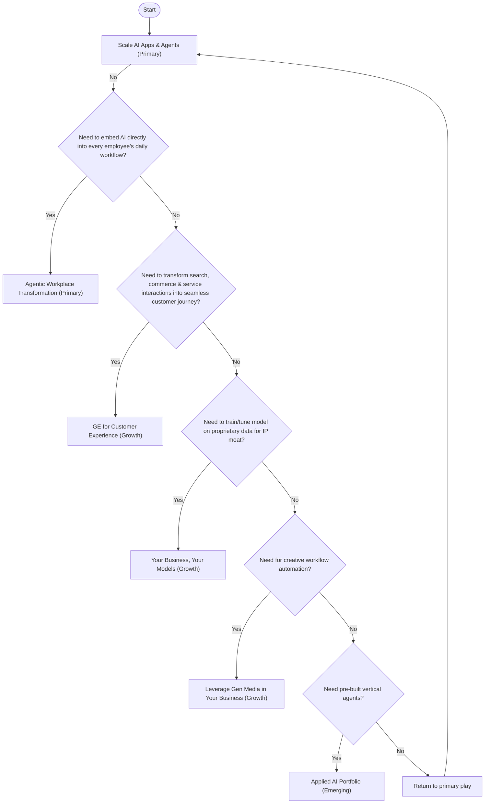

# FY26 AI Sales Play Decision Tree

This reference helps in selecting the appropriate AI sales play based on
customer needs.

## Decision Tree Diagram

## Details

### 1. Scale AI Apps & Agents [Primary]

-   **Criteria**: Customer needs to build, deploy or consolidate apps/agents
    into a production-ready, governed platform. Needs access to SOTA (State Of
    The Art) models.
-   **Keywords**: Gemini, Anthropic, API Consumption on Vertex AI platform.
-   **Note**: *ALWAYS START HERE*

### 2. Agentic Workplace Transformation [Primary]

-   **Criteria**: Need to embed AI directly into every employee's daily
    workflow.
-   **Action**: Create agentic workplace transformation, empowering every
    employee across workflows with AI for internal productivity purposes.
-   **Keywords**: Gemini Enterprise, Google Workspace.

### 3. GE for Customer Experience [Growth]

-   **Criteria**: Need to transform search, commerce & service interactions into
    a seamless customer journey.
-   **Keywords**: Gemini Enterprise for Customer Experience, VAIS, CES, Shopping
    Agent. Includes food ordering.

### 4. Your Business, Your Models [Growth]

-   **Criteria**: Need to train/tune model on proprietary data for IP moat.
-   **Action**: Customer developing proprietary model and values time to
    production with a fully managed service.
-   **Keywords**: Agent Platform, GPU/TPU.

### 5. Leverage Gen Media in Your Business [Growth]

-   **Criteria**: Need for creative workflow automation.
-   **Action**: Content generation or creative editing tools. ISVs and software
    vendors for creative processes, consumer content creation / publishing apps
    & tools.
-   **Keywords**: Veo, Imagen, Lyria, Chirp.

### 6. Applied AI Portfolio [Emerging]

-   **Criteria**: Need pre-built vertical agents (Auto).
-   **Action**: Customer wants "ready-to-deploy" agent for a specific industry
    (Auto) function.
