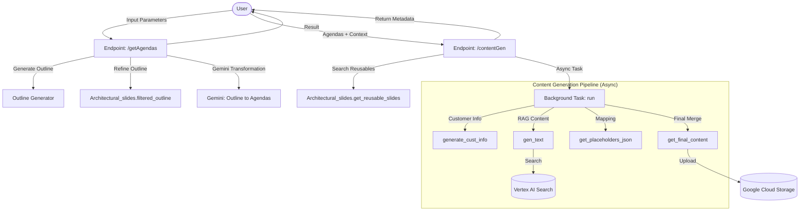

# Jetski V2 Flow Diagram and Agent Structure

This document outlines the architectural flow, agent definitions, and data structures of the Jetski V2 application.

## 1. System Flow Overview

The system operates primarily as a FastAPI application that orchestrates a multi-step pipeline for generating presentation slides. It combines generative AI with a retrieval system for existing architectural assets.



---

## 2. Agent and Component Structure

### 2.1. Main API Orchestrator (`main.py`)
The primary entry point that manages the state and sequence of operations.

#### Endpoint: `/getAgendas`
*   **Purpose**: Creates a structured agenda from high-level business context.
*   **Input (`Parameters`)**:
    ```json
    {
      "business_context": "string",
      "region": "string",
      "industry": "string",
      "er_number": "string",
      "customer_name": "string",
      "audience": ["string"],
      "solution": ["string"],
      "product": ["string"],
      "salesPlay": ["string"]
    }
    ```
*   **Output**: A comprehensive JSON object containing the `outline` and structured `agendas` (list of topics and sub-topics).

#### Endpoint: `/contentGen`
*   **Purpose**: Generates the actual slide content and maps them to templates.
*   **Input (`Fields_V1`)**: Extends `Parameters` with the `agendas` generated in the previous step.
*   **Output**: 
    ```json
    [
      { "slides_result": "..." },
      { "filename": "..." },
      { "agenda": "count" },
      { "reusableslide": "count" },
      { "gsurl": "gs://..." }
    ]
    ```

---

### 2.2. ADK Agent (`agent.py`)
A standalone agent interface using the Google ADK framework, designed for payload-driven interactions.

#### Agent: `slide_generator_agent_payloadinputoupt`
*   **Tool**: `slide_generator_skill`
*   **Flow**:
    1.  **Parse Payload**: Validates input JSON.
    2.  **Reusable Check**: Calls `Architectural_slides` to see if existing slides match the agenda.
    3.  **Fallback Generation**: If reusables are insufficient, it triggers `generate_slide_content` and `process_slides_with_templates`.
    4.  **Upload & Return**: Saves result to GCS and returns the JSON payload.

---

### 2.3. Sub-Components (Skills)

#### A. `Architectural_slides` (`src/reusable_slides.py`)
*   **Function**: Acts as a "Selector Agent" for existing assets.
*   **Input**: Agenda items and customer context.
*   **Output**: List of matching reusable slide URLs and metadata.

#### B. `gen_text` (`src/new_content_gen.py`)
*   **Function**: Generative Content Agent.
*   **Strategy**: Uses RAG (Retrieval-Augmented Generation).
*   **Input**: Task list (agendas), URL list for context.
*   **Output**: Formatted text content for each slide.

#### C. `template_sorting` (`src/template_sorting.py`)
*   **Function**: Mapping Agent.
*   **Input**: Generated text content.
*   **Output**: JSON mapping of content to specific slide placeholders based on layout classification.

---

## 3. Data Structures

### Agenda Structure
```json
{
  "1": {
    "title": "Topic Title",
    "parts": ["Sub-topic 1", "Sub-topic 2"],
    "reusable": "count_limit",
    "generated": "count_limit"
  }
}
```

### Final Slide Structure (JSON)
```json
{
  "sections": {
    "0": {
      "slides": {
        "1": {
          "temp_url": "https://docs.google.com/presentation/d/.../edit#slide=id.g...",
          "placeholders": {
            "title": "Slide Title",
            "content": "..."
          }
        }
      }
    }
  }
}
```

---

## 4. Specialized Endpoints

| Endpoint | Input | Output | Description |
| :--- | :--- | :--- | :--- |
| `/addSlide` | `Slides` model | New Slide Object | Generates content for a specific new slide. |
| `/reShuffle` | `Shuffle` model | Transformed URL | Re-generates or re-layouts an existing slide. |
| `/translate` | `translationData` | Translated URL | Translates slide content into a target language. |
| `/searchSlide`| `searchSchema` | Search Results | Vector search across existing slide decks. |
