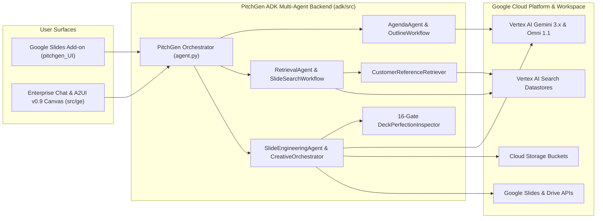

# PitchGen Technical Documentation & Deployment Guide

## 1. Architecture Overview

PitchGen uses a modular **Multi-Agent Architecture** built on the **Google Agent Development Kit (ADK)** that serves two interactive surfaces simultaneously:
1. **Google Slides Add-on (`pitchgen_UI/`)**: Embedded directly inside Google Slides via Google Apps Script (`sideBar.html` and `userInputPopup.html`).
2. **Enterprise Conversational UI (`adk/src/ge/`)**: Renders rich **A2UI v0.9** interactive cards (Intake forms, Outline review cards, Slide search carousels, and Google Slides Canvas artifacts).



---

## 2. Model Configuration (`adk/src/config/config.ini`)

PitchGen is configured out-of-the-box for the latest **Gemini 3.x** and **Gemini Omni 1.1** model family on Vertex AI:

| Config Key | Default Model | Purpose |
| :--- | :--- | :--- |
| `gemini_model` | `gemini-3.8-flash` | Primary reasoning model (`ThinkingLevel.MEDIUM`) for CVI outlines, slide copywriting, and layout mapping |
| `gemini_model_1` | `gemini-3.5-flash-lite` | High-throughput classification, entity extraction, and metadata validation |
| `gemini_image_model_1` | `gemini-3.1-flash-image` | Fast bespoke slide visual and 3D isometric illustration synthesis |
| `gemini_image_model_2` | `gemini-3-pro-image` | High-fidelity visual restyling and editorial graphic synthesis |
| `gemini_video_model` | `gemini-omni-1.1-flash-preview` | Video-to-Video (`task="edit"`) customization of animated UI demo GIFs |
| `embedding_model` | `text-embedding-005` | 768-dimensional semantic slide embeddings for multi-factor retrieval scoring |

---

## 3. Vertex AI Search Datastores

Configure two structured Vertex AI Search (Discovery Engine) datastores in your GCP project and set their IDs in `adk/src/config/config.ini` under `[reusable]`:

1. **`sales_play_reusables`**:
   - Stores metadata for reusable solution, architecture, market trend, and foundation slides.
   - Recommended schema fields: `deck_id`, `slide_id`, `slide_title`, `deck_title`, `slide_summary`, `slide_job`, `cvi_cluster`, `industry`, `google_product`, `sales_play`, `core_topics`, `desc_embedding`.
2. **`cust_ref`**:
   - Stores verified customer reference / case study slides (`Proof_Points`).
   - Recommended schema fields: `customer_name`, `industry`, `sub_industry`, `asset_url` (`https://docs.google.com/presentation/d/<deck_id>/edit#slide=id.<slide_id>`), `google_products`, `quantifiable_business_impact`, `description`.

---

## 4. Slide Template Library Setup

PitchGen separates **slide narrative synthesis** from **visual template geometry**:
1. Host your master Google Slides template decks in Google Drive (accessible to the service account and end users).
2. Update `adk/src/config/mapping.json` with the `deckId` and `slide_id` mappings for your `title`, `agenda`, `section` (divider), and `thank` (closing) slides.
3. Update `adk/src/templates_metadata/*.txt` with your template deck IDs (`<template_number>@<deck_id>@<slide_id>`) and shape placeholder coordinates.

---

## 5. Deploying the Google Slides Add-on (`pitchgen_UI/`)

1. Install `clasp` and authenticate with your Google Workspace account:
   ```bash
   npm install -g @google/clasp
   clasp login
   ```
2. Update `pitchgen_UI/.clasp.json` with your Apps Script `scriptId` and `pitchgen_UI/configuration.js` with your GCP project and backend URLs.
3. Push and deploy the Add-on:
   ```bash
   cd pitchgen_UI
   clasp push
   clasp deploy
   ```
